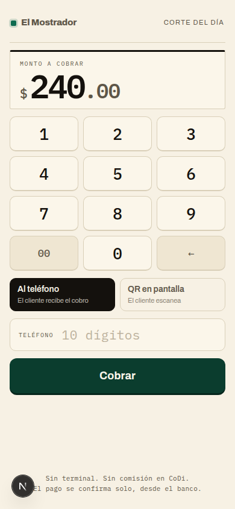
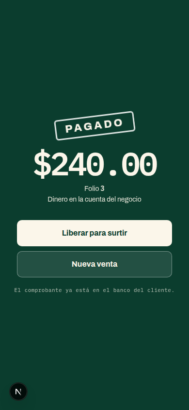
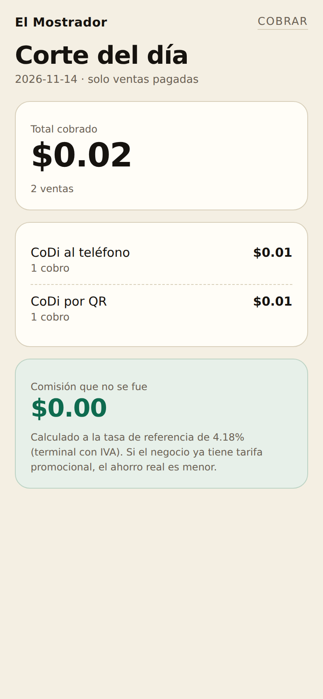

# El Mostrador

Cobro con CoDi desde el celular del dependiente. Sin terminal, sin comisión.

Una pantalla: monto, teléfono del cliente, cobrar. El cliente recibe el cobro en su
banco y la pantalla se pone verde sola. Al cierre del día, el corte por método y
cuánto se dejó de pagar en comisión.

**Hackatón México 2026** — pista principal: uso de CoDi y del API de pey.

| Cobrar | Pagado | Corte |
|---|---|---|
|  |  |  |

---

## Estado actual

Funciona y está probado de punta a punta contra un pey simulado (`scripts/smoke.mjs`):

| Pieza | Estado |
|---|---|
| Cobro CoDi por push (`POST /codi/pn`) | ✅ |
| Cobro CoDi por QR (`POST /codi/qr`) | ✅ pantalla con el QR y espera |
| Webhook con firma Standard Webhooks | ✅ verificada antes de parsear |
| Idempotencia por `webhook-id` | ✅ |
| Reconciliación por `GET /transaction/{id}` | ✅ respaldo si el webhook no llega |
| Reconciliación en segundo plano (cada 30 s) | ✅ el verde no depende del webhook ni de la pantalla abierta |
| Máquina de estados de la venta | ✅ 27 pruebas |
| Corte del día por método + comisión evitada | ✅ |
| Liberar venta para surtir | ✅ (la "acción verificable") |
| Pantalla de cobro y de corte | ✅ responsive, teclado numérico grande |
| Landing pública que explica el producto | ✅ `/` |
| Instalable en el celular (manifest + iconos) | ✅ `/cobrar` |
| Push real contra `api.pey.mx` | ✅ probado con $0.01 |

---

## Cómo correrlo

Requiere **Node 22 o superior** (usa `node:sqlite`, sin dependencias nativas).

Para desplegar en producción con Dokploy, ver **[docs/DEPLOY.md](docs/DEPLOY.md)**.

```bash
npm install
cp .env.example .env.local     # llena PEY_API_KEY y PEY_WEBHOOK_SECRET
npm run dev                    # http://localhost:3000
```

Pruebas y tipos:

```bash
npm test          # 27 pruebas: estados, firma, validación, store
npm run typecheck
```

Prueba de humo de punta a punta (levanta un pey falso, no gasta saldo):

```bash
npm run build
PEY_API_KEY=test \
PEY_WEBHOOK_SECRET=whsec_$(printf 'secreto-de-humo' | base64) \
PEY_BASE_URL=http://127.0.0.1:3901 \
DATA_DIR=.data-smoke \
npx next start -p 3100

# en otra terminal:
APP_URL=http://127.0.0.1:3100 node scripts/smoke.mjs
```

---

## Cómo se usa en el mostrador (piloto)

**No se instala desde una tienda.** Es una web app: el dependiente abre la URL en su celular
y la agrega a la pantalla de inicio (Compartir → Agregar a inicio). Desde ahí se abre a pantalla
completa, como cualquier app. No hay tienda, no hay APK, no hay cuenta que crear.

El flujo es uno solo, y es el de la pantalla de cobro:

1. Teclea el monto en el teclado grande.
2. Elige **al teléfono** (el cliente recibe una solicitud de pago en su banco) o **QR en
   pantalla** (el cliente escanea desde su app).
3. La pantalla se pone verde sola cuando el banco confirma. No se revisa nada a mano.

**Qué no se imprime:** en el piloto no hay QR fijo de la tienda. Un QR fijo obliga al cliente a
escribir el monto y **pierde el folio**, que es lo que amarra la venta con el pago en el corte.
El QR se genera por venta y se muestra en la pantalla. El QR fijo sin monto y sin expiración
(`amount: 0`, `expiration: 0`) queda como siguiente paso, para la calcomanía del mostrador.

**Tiempos:** el push expira en 6 minutos y el QR en 10. Si expira, se recobra con el mismo folio.

---

## Endpoints

| Método | Ruta | Qué hace |
|---|---|---|
| `POST` | `/api/ventas` | Crea la venta y dispara el cobro (push o QR) |
| `GET` | `/api/ventas/:folio` | Estado; reconcilia contra pey si sigue `cobrando` |
| `POST` | `/api/ventas/:folio/liberar` | Solo si está pagada: libera el material para surtir |
| `POST` | `/api/ventas/:folio/cancelar` | Cancela si aún no está pagada |
| `POST` | `/api/webhooks/pey` | Firma → dedupe → marca pagada |
| `GET` | `/api/corte?dia=YYYY-MM-DD` | Totales por método + comisión evitada |
| `GET` | `/api/salud` | Diagnóstico: ¿el webhook está entrando o solo el respaldo? |

El contrato real del webhook, capturado con pagos de $0.01: **[docs/WEBHOOK-REAL.md](docs/WEBHOOK-REAL.md)**.

### Máquina de estados

```
creada → cobrando → pagada → liberada
              ↓
           expirada → cobrando (recobro con el mismo folio)
              ↓
          cancelada → pagada (pago tardío: el cliente ya había escaneado)
```

`pagada` **solo** se alcanza por webhook verificado o por consulta a
`GET /transaction/{id}`. Nunca por el redirect del navegador.

**Y no depende de que el webhook llegue.** Al arrancar el servidor (`instrumentation.ts`) se
enciende un ciclo que cada 30 s reconcilia las ventas que siguen en `cobrando`: si el
dependiente cobra, guarda el celular y se va a surtir, la venta se cierra sola y aparece en
el corte. Se apaga con `RECONCILIACION=off`.

---

## Decisiones que importan

1. **El folio es el `numRef`.** La transacción de pey no dice quién pagó: sin
   referencia propia no hay conciliación posible. `numRef` ≤ 7 dígitos.
2. **La firma se verifica sobre el cuerpo crudo**, antes de `JSON.parse`. El
   `webhook-id` es la llave de idempotencia: el mismo evento no se procesa dos veces.
3. **El teléfono del pagador no se guarda.** Viaja a pey para disparar el push y
   se descarta. No hay historial de clientes.
4. **Montos en centavos enteros.** Cero floats en la base.
5. **El corte es del día en CDMX** (UTC−6), no del servidor en UTC.
6. **La comisión evitada usa la tasa de referencia de la terminal con IVA (4.18%)**
   y se dice en pantalla: si el negocio ya tiene tarifa promocional, el ahorro real
   es menor. No se infla el número.
7. **SQLite local con el módulo nativo de Node.** La persistencia está aislada en
   `lib/store.ts` para cambiar a Postgres en producción sin tocar las rutas.

---

## Lo que falta

- [ ] Pantalla del QR (el backend ya lo genera)
- [ ] Push real con la API key del negocio y CLABE propia
- [ ] Devoluciones (CoDi solo cobra: el reembolso es SPEI manual y se registra)
- [ ] Postgres para producción
- [ ] Capa de cotización (siguiente iteración: el ticket de $3,000 es una obra, no un tornillo)
- [ ] Tests de integración de la ruta de webhook con base real

---

## Atribución

```md
## Built at Hackatón México 2026

Durante el hackatón se construyó: la integración con el API de pey
(cobros CoDi por push y QR, verificación de webhooks, idempotencia,
reconciliación, corte del día y liberación de la venta).
```
